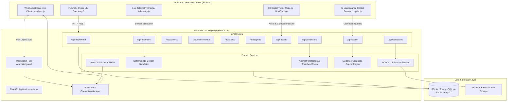

# 🛡️ VisionGuard AI 2.0: Industrial Intelligence & Digital Twin Platform

[](https://www.python.org/)
[](https://fastapi.tiangolo.com/)
[](https://github.com/ultralytics/ultralytics)
[](https://threejs.org/)
[](https://www.sqlalchemy.org/)
[](https://developer.mozilla.org/en-US/docs/Web/API/WebSockets_API)
[](https://docs.pytest.org/)

**VisionGuard AI 2.0** is an enterprise-grade industrial command center and preventive maintenance intelligence platform designed for conveyor belt operations. Built with a high-performance Python/FastAPI backend, real Ultralytics YOLOv11 computer vision, an interactive Three.js 3D mechanical digital twin, a deterministic software-only sensor simulation engine, explainable ISO 10816 anomaly indicators, real-time WebSocket event streaming, and an evidence-grounded AI Maintenance Copilot.

---

## 📑 Table of Contents
1. [System Architecture](#-system-architecture)
2. [Complete Feature Catalog](#-complete-feature-catalog)
3. [Operational Transparency: Real vs. Simulated](#-operational-transparency-real-vs-simulated)
4. [Interactive 3D Digital Twin](#-interactive-3d-digital-twin)
5. [AI Computer Vision Defect Detection](#-ai-computer-vision-defect-detection)
6. [Software Sensor Simulator & Anomaly Engine](#-software-sensor-simulator--anomaly-engine)
7. [Evidence-Grounded AI Maintenance Copilot](#-evidence-grounded-ai-maintenance-copilot)
8. [Real-Time WebSocket Event Hub](#-real-time-websocket-event-hub)
9. [Maintenance Automation & Work Orders](#-maintenance-automation--work-orders)
10. [REST & WebSocket API Directory](#-rest--websocket-api-directory)
11. [Database Schema & ER Models](#-database-schema--er-models)
12. [Quickstart & Windows Installation](#-quickstart--windows-installation)
13. [Environment Configuration](#-environment-configuration)
14. [Automated Testing Suite (42 Tests)](#-automated-testing-suite)
15. [Repository Structure](#-repository-structure)

---

## 🏗️ System Architecture



---

## 🌟 Complete Feature Catalog

### 1. 🌐 Interactive 3D Digital Twin (Three.js WebGL)
- **Mechanical Conveyor Assembly**: Realistically models the drive motor, gearbox, head drive roller, tail tension roller, carry idler sets, return idlers, steel structural trusses, safety handrails, and feed hopper.
- **Dynamic Motion**: Rubber belt texture scrolls along the conveyor bed at a rate mathematically synchronized with simulated belt speed.
- **Raycast Selection**: Interactive 3D raycasting detects mouse hovering and clicks on individual mechanical components.
- **Diagnostic Inspector**: Clicking any component immediately shifts camera focus, highlights the geometry with an emissive cyan glow, and displays live operating state, health score (%), and vibration RMS in the side inspector.
- **Defect Overlays**: Toggle glowing 3D beacon markers directly over defect coordinates on the belt (cracks, tears, and roller misalignment).
- **Global Asset Switcher**: Seamlessly switch between different conveyor lines (`CONV-01`, `CONV-02`, `CONV-03`) with live component re-mapping.

### 2. 🔍 Real AI Defect Detection (YOLOv11 & OpenCV)
- **Supported Conveyor Defect Classes**:
  1. **Cracks**: Surface fatigue, transverse or longitudinal belt fractures.
  2. **Tears**: Severe longitudinal punctures or rips requiring immediate patching.
  3. **Misalignment**: Lateral drift, belt wander, tracking skew, or edge wear.
  4. **Roller Faults**: Seized idlers, roller tilt, surface buildup, or bearing failure.
  5. **Material Spillage**: Bulk material overflow, skirting seal leaks, or carryback buildup.
- **Inference Pipeline**: Real OpenCV preprocessing, image normalization, bounding box rendering, percentage confidence scoring, and color-coded severity tagging.
- **Graceful Weight Handling**: If `models/best.pt` weights are missing, the system responds with a clear HTTP 400 schema detailing training/placement steps without crashing.
- **Video & Stream Support**: Batch frame-by-frame analysis with annotated video output and FPS/latency profiling.

### 3. ⚡ Software-Only Deterministic Sensor Simulator
- **Zero External Hardware Required**: Simulates complex industrial PLC/sensor networks in software.
- **5 Instrumented Channels**:
  - **Vibration RMS** (`mm/s`): Overall mechanical vibration velocity (ISO 10816 standards).
  - **Motor Temperature** (`°C`): Winding and stator surface temperature.
  - **Motor Current** (`A`): Electrical current draw and load monitoring.
  - **Belt Speed** (`m/s`): Linear conveyor belt surface speed.
  - **Bearing Temperature** (`°C`): Drive and tail pulley bearing block temperatures.
- **5 Injection Scenarios**:
  - `normal`: Stable, healthy operating baseline.
  - `vibration_increase`: Simulates gradual bearing flaking and imbalance.
  - `temp_anomaly`: Simulates cooling blockage or overload overheating.
  - `belt_speed_variation`: Simulates pulley slippage and belt sag.
  - `combined_anomaly`: Compound multi-failure cascading scenario.
- **Audit Compliance**: All readings explicitly stamped with `source="simulation"` across database records and API responses.

### 4. 🧠 Explainable Equipment Anomaly Detection
- **Multi-Tier Classification**: Strictly distinguishes between **Visual Surface Defects (YOLO)**, **Sensor Anomalies (Thresholds)**, and **Failure Predictions**.
- **ISO 10816-3 Threshold Engine**: Compares vibration and temperatures against industrial limits (Warning: 4.5 mm/s, Critical: 7.1 mm/s).
- **Explainable Indicators**: Surfaces the exact feature, measured value, threshold breached, and remediation recommendation.
- **IsolationForest Pipeline Ready**: Includes data framing for unsupervised machine learning anomaly detection.

### 5. 🤖 Evidence-Grounded AI Maintenance Copilot
- **Interactive Cyber Drawer**: Accessible from any page in the command center.
- **Grounded Retrieval Engine**: Queries real SQL database records (inspections, detections, active work orders, alerts, and sensor telemetry).
- **Zero Hallucination Guarantee**: The copilot only answers using retrieved database records. If an asset has no defects, it explicitly confirms zero defects rather than fabricating issues.
- **Evidence Citations**: Displays clickable verification badges citing source records (e.g., `[INSPECTION #3]`, `[TELEMETRY CONV-01]`, `[TASK #12]`).
- **Zero-API-Key Operation**: Runs out-of-the-box using the local deterministic grounding engine. Optional integration with OpenAI or Claude models via `.env`.

### 6. 📡 Real-Time Full-Duplex WebSocket Hub
- **Endpoint**: `/ws/visionguard`
- **Broadcast Events**: `telemetry.updated`, `inspection.completed`, `detection.created`, `maintenance.updated`, `alert.created`, `asset.status_changed`.
- **Auto-Reconnect**: Client automatically reconnects using exponential backoff (1s, 2s, 4s, up to 10s max).
- **Live Notifications**: Non-intrusive cyber toast alerts display for high-priority defects and sensor anomalies.

### 7. 🛠️ Preventive Maintenance Automation
- **Automated Work Orders**: Critical and High severity detections automatically generate preliminary maintenance tickets.
- **Full Lifecycle Tracking**: Manage tasks through `Pending`, `In Progress`, `Completed`, and `Cancelled` states.
- **Resource Allocation**: Assign technicians, set due dates, update severity, and maintain audit notes.
- **Engineer Review Notice**: AI severity ratings are explicitly flagged as preliminary until approved by certified plant maintenance engineers.

### 8. 📹 Live Industrial Camera Monitoring
- **RTSP & Webcam Ingestion**: Connects to USB device indexes (`0`, `1`) or industrial IP camera RTSP streams (e.g., `rtsp://192.168.1.100:554/live`).
- **MJPEG Streaming**: Low-latency live browser stream with dynamic defect bounding boxes.
- **Smart Throttling**: 5-second cooldown filter prevents redundant alert spam during continuous exposure.

---

## 🔍 Operational Transparency: Real vs. Simulated

| Platform Capability | Operational Status | Implementation Details |
| :--- | :--- | :--- |
| **YOLOv11 Defect Inference** | **REAL** | Real OpenCV + Ultralytics YOLOv11 model running against uploaded images, videos, and RTSP feeds. Generates real bounding boxes and confidence scores. |
| **Missing Model Handling** | **REAL** | Graceful fallback returning structured HTTP 400 error schema with remediation instructions without crashing. |
| **Database Persistence** | **REAL** | SQLAlchemy 2.0 ORM storing real inspections, detections, maintenance work orders, alerts, assets, and telemetry in SQLite/PostgreSQL. |
| **Live WebSockets** | **REAL** | Full-duplex WebSocket event bus at `/ws/visionguard` with auto-reconnect backoff and live UI toasts. |
| **3D Conveyor Digital Twin** | **REAL (Procedural 3D)** | Interactive Three.js WebGL model with Raycasting, component selection, defect overlay beacons, and animated belt motion. |
| **Sensor Telemetry Simulator** | **SIMULATED (Software-Only)** | Deterministic mathematical simulation generating vibration, temperature, current, and speed. All readings tagged with `source="simulation"`. |
| **Explainable Anomaly Detection** | **REAL (Threshold Rules + ML Ready)** | Validated threshold-based anomaly detection checking ISO 10816 limits. scikit-learn IsolationForest pipeline ready. |
| **AI Maintenance Copilot** | **REAL (Grounded) / OPTIONAL (LLM)** | Deterministic local grounding engine querying actual DB records (zero API keys required). Optional cloud LLM support via `.env`. |
| **Physical PLC Actuation** | **UNAVAILABLE / SIMULATED** | The application does not send electrical stop signals to physical factory PLCs without a hardware fieldbus gateway. |

---

## 📋 REST & WebSocket API Directory

### Equipment Assets & Components
| Method | Endpoint | Description |
| :--- | :--- | :--- |
| `GET` | `/api/assets` | List all conveyor assets and their health scores |
| `GET` | `/api/assets/{asset_id}` | Get specific asset details and component inventory |
| `GET` | `/api/assets/{asset_id}/components` | List all mechanical components for an asset |
| `GET` | `/api/assets/{asset_id}/components/{comp_id}` | Get component operating diagnostics and health |
| `GET` | `/api/assets/{asset_id}/summary` | Aggregate health score, defect counts, and active tasks |

### Software Sensor Simulator & Telemetry
| Method | Endpoint | Description |
| :--- | :--- | :--- |
| `GET` | `/api/telemetry/scenarios` | List available simulation scenarios |
| `GET` | `/api/telemetry/channels` | List all 5 sensor channels and operational units |
| `GET` | `/api/telemetry/latest?asset_id=CONV-01` | Get the most recent readings for all channels |
| `POST` | `/api/telemetry/simulate/step` | Advance deterministic simulation clock by 1 step |
| `POST` | `/api/demo/scenarios/{scenario_name}` | Inject specific fault scenario into asset telemetry |

### Anomaly Predictions & ISO Rules
| Method | Endpoint | Description |
| :--- | :--- | :--- |
| `GET` | `/api/predictions/status?asset_id=CONV-01` | Get anomaly engine status and current indicator rules |
| `GET` | `/api/predictions/anomalies` | Query persisted equipment anomaly records |

### AI Maintenance Copilot
| Method | Endpoint | Description |
| :--- | :--- | :--- |
| `GET` | `/api/copilot/status` | Verify copilot engine readiness and LLM configuration |
| `POST` | `/api/copilot/ask` | Submit conversational question; returns grounded answer & evidence |
| `GET` | `/api/copilot/history/{session_id}` | Retrieve chat session history |

### Real-Time WebSocket Streaming
| Protocol | Endpoint | Description |
| :--- | :--- | :--- |
| `WS` | `/ws/visionguard` | Full-duplex WebSocket hub for live telemetry and system events |

### Core Computer Vision, Maintenance & Dashboard
| Method | Endpoint | Description |
| :--- | :--- | :--- |
| `GET` | `/api/health` | System health check (DB connection & YOLO model state) |
| `GET` | `/api/dashboard/summary` | Aggregate KPI statistics, defect trends, and distributions |
| `POST` | `/api/detections/image` | Upload image for YOLOv11 defect detection |
| `POST` | `/api/detections/video` | Upload video feed for frame-by-frame analysis |
| `GET` | `/api/detections` | Query inspection history with filtering options |
| `GET` | `/api/detections/{id}` | Retrieve individual inspection and detection records |
| `GET` | `/api/maintenance` | List preventive maintenance work orders |
| `POST` | `/api/maintenance` | Create a new maintenance work order |
| `PUT` | `/api/maintenance/{id}` | Update task status, technician, priority, or notes |
| `GET` | `/api/alerts` | List unread and historical plant alerts |
| `PUT` | `/api/alerts/{id}/read` | Mark alert as acknowledged |
| `GET` | `/api/reports/inspections` | Inspection summary metrics |
| `GET` | `/api/reports/export` | Download full CSV inspection report |
| `POST` | `/api/camera/start` | Start live webcam / RTSP camera stream |
| `POST` | `/api/camera/stop` | Terminate live camera stream |
| `GET` | `/api/camera/status` | Check live camera stream status |
| `GET` | `/api/camera/feed` | MJPEG video stream with real-time bounding boxes |

---

## 🗄️ Database Schema & ER Models

The database schema is powered by **SQLAlchemy 2.0** and supports local SQLite (`visionguard.db`) and PostgreSQL.

### Database Tables:
1. **`assets`**: Equipment lines (`asset_id`, `name`, `description`, `location`, `status`, `health_score`, `created_at`).
2. **`components`**: Mechanical sub-assemblies (`component_id`, `asset_id`, `name`, `component_type`, `status`, `health_score`, `last_inspected`, `metadata_json`).
3. **`telemetry_readings`**: Time-series sensor entries (`id`, `asset_id`, `component_id`, `channel`, `value`, `unit`, `source`, `scenario`, `timestamp`).
4. **`anomaly_predictions`**: Equipment anomalies (`id`, `asset_id`, `component_id`, `anomaly_type`, `anomaly_score`, `confidence`, `severity`, `model_version`, `detection_method`, `evidence_json`, `is_acknowledged`, `created_at`).
5. **`copilot_sessions`**: Assistant conversations (`session_id`, `user_id`, `message_count`, `last_active`, `history_json`).
6. **`inspections`**: Visual inspection runs (`id`, `filename`, `media_type`, `original_path`, `result_path`, `status`, `defects_count`, `high_priority_count`, `processing_time_ms`, `created_at`).
7. **`detections`**: Individual detected defects (`id`, `inspection_id`, `defect_class`, `confidence`, `severity`, `bbox`, `frame_number`, `created_at`).
8. **`maintenance_tasks`**: Work orders (`id`, `inspection_id`, `detection_id`, `title`, `defect_class`, `severity`, `assigned_personnel`, `due_date`, `status`, `notes`, `created_at`, `updated_at`).
9. **`alerts`**: System alerts (`id`, `inspection_id`, `title`, `message`, `severity`, `is_read`, `created_at`).
10. **`settings`**: Configuration key-values (`id`, `key`, `value`, `description`, `updated_at`).

---

## 🚀 Quickstart & Windows Installation

### Prerequisites
- Python 3.10 to 3.13 installed.
- Git installed.

### Step 1: Clone the Repository
```powershell
git clone https://github.com/kunalb2025aids-coder/VisionGuard.git
cd VisionGuard
```

### Step 2: (Optional) Setup Virtual Environment
```powershell
python -m venv venv
.\venv\Scripts\Activate.ps1
```

### Step 3: Install Dependencies
```powershell
pip install -r requirements.txt
```

### Step 4: Configure Environment
```powershell
Copy-Item .env.example .env
```
*(By default, SQLite is automatically used with zero manual database configuration).*

### Step 5: Verify Automated Test Suite
```powershell
python -m pytest tests/ -v
```
*(All 42 tests will execute and pass in ~11 seconds).*

### Step 6: Launch VisionGuard AI 2.0
```powershell
python -m uvicorn backend.app.main:app --host 0.0.0.0 --port 8000 --reload
```

### Step 7: Open in Browser
- **Web Command Center**: [http://localhost:8000](http://localhost:8000)
- **Interactive Swagger Documentation**: [http://localhost:8000/docs](http://localhost:8000/docs)
- **Health Verification Endpoint**: [http://localhost:8000/api/health](http://localhost:8000/api/health)

---

## ⚙️ Environment Configuration

Configuration is managed via `.env` (refer to `.env.example`):

```ini
# App Settings
APP_NAME="VisionGuard AI 2.0"
DEBUG=True
PORT=8000
HOST="0.0.0.0"

# Database (SQLite by default, PostgreSQL optional)
DATABASE_URL="sqlite:///./visionguard.db"

# CORS Configuration
ALLOWED_ORIGINS="*"

# YOLO Model Settings
MODEL_PATH="models/best.pt"
CONFIDENCE_THRESHOLD=0.25

# Optional SMTP Email Alerts
SMTP_ENABLED=False
SMTP_HOST="smtp.gmail.com"
SMTP_PORT=587
SMTP_USER="alerts@visionguard.ai"
SMTP_PASSWORD="your-app-password"
ALERT_RECIPIENT_EMAIL="maintenance@factory.com"

# Optional Cloud LLM for AI Copilot (Empty = Local Grounded Engine)
LLM_PROVIDER=""
LLM_API_KEY=""
LLM_MODEL="gpt-4o-mini"

# Telemetry Simulator
DEFAULT_SIMULATION_SCENARIO="normal"
```

---

## 🧪 Automated Testing Suite

VisionGuard AI 2.0 includes a comprehensive automated test suite covering all services, routers, models, and real-time streaming:

```powershell
python -m pytest -v
```

```
============================= test session starts =============================
platform win32 -- Python 3.13.14, pytest-9.1.1, pluggy-1.6.0
collected 42 items

tests/test_api.py::test_health_check PASSED                              [  2%]
tests/test_api.py::test_dashboard_summary_empty PASSED                   [  4%]
tests/test_api.py::test_list_alerts PASSED                               [  7%]
tests/test_assets.py::test_list_assets_seeds_defaults PASSED             [  9%]
tests/test_assets.py::test_get_asset_by_code PASSED                      [ 11%]
tests/test_assets.py::test_get_asset_not_found PASSED                    [ 14%]
tests/test_assets.py::test_get_asset_components PASSED                   [ 16%]
tests/test_assets.py::test_get_component_by_id PASSED                    [ 19%]
tests/test_assets.py::test_asset_summary PASSED                          [ 21%]
tests/test_camera.py::test_camera_status_endpoint PASSED                 [ 23%]
tests/test_camera.py::test_camera_stop_endpoint PASSED                   [ 26%]
tests/test_copilot.py::test_copilot_status PASSED                        [ 28%]
tests/test_copilot.py::test_copilot_ask_no_llm PASSED                    [ 30%]
tests/test_copilot.py::test_copilot_ask_evidence_retrieval PASSED        [ 33%]
tests/test_copilot.py::test_copilot_ask_validation PASSED                [ 35%]
tests/test_copilot.py::test_copilot_history PASSED                       [ 38%]
tests/test_copilot.py::test_copilot_no_fabricated_predictions PASSED     [ 40%]
tests/test_detections.py::test_invalid_file_extension_rejected PASSED    [ 42%]
tests/test_detections.py::test_unsafe_filename_sanitization PASSED       [ 45%]
tests/test_detections.py::test_missing_model_weights_response PASSED     [ 47%]
tests/test_maintenance.py::test_create_and_update_maintenance_task PASSED [ 50%]
tests/test_predictions.py::test_prediction_status PASSED                 [ 52%]
tests/test_predictions.py::test_threshold_anomaly_detection PASSED       [ 54%]
tests/test_predictions.py::test_normal_readings_no_anomaly PASSED        [ 57%]
tests/test_predictions.py::test_list_anomalies_empty PASSED              [ 59%]
tests/test_predictions.py::test_anomaly_created_by_simulation PASSED     [ 61%]
tests/test_predictions.py::test_prediction_status_no_ml_fabrication PASSED [ 64%]
tests/test_reports.py::test_inspections_report_summary PASSED            [ 66%]
tests/test_reports.py::test_export_reports_csv PASSED                    [ 69%]
tests/test_telemetry.py::test_list_scenarios PASSED                      [ 71%]
tests/test_telemetry.py::test_list_channels PASSED                       [ 73%]
tests/test_telemetry.py::test_simulate_step_normal PASSED                [ 76%]
tests/test_telemetry.py::test_simulate_deterministic_with_seed PASSED    [ 78%]
tests/test_telemetry.py::test_simulate_persists_to_db PASSED             [ 80%]
tests/test_telemetry.py::test_simulate_unknown_scenario PASSED           [ 83%]
tests/test_telemetry.py::test_simulate_unknown_asset PASSED              [ 85%]
tests/test_telemetry.py::test_vibration_increase_scenario PASSED         [ 88%]
tests/test_telemetry.py::test_demo_scenario_endpoint PASSED              [ 90%]
tests/test_telemetry.py::test_latest_readings PASSED                     [ 92%]
tests/test_ws.py::test_ws_connection_and_welcome PASSED                  [ 95%]
tests/test_ws.py::test_ws_ping_pong PASSED                               [ 97%]
tests/test_ws.py::test_ws_event_schema PASSED                            [100%]

======================== 42 passed in 10.86s =========================
```

---

## 📁 Repository Structure

```
d:/data science project/
├── backend/
│   └── app/
│       ├── main.py                     # FastAPI application entry point & CORS
│       ├── models/
│       │   ├── database.py             # SQLAlchemy session manager & engine
│       │   └── entities.py             # 10 ORM database entity classes
│       ├── routers/
│       │   ├── __init__.py
│       │   ├── alerts.py               # Plant alerts router
│       │   ├── assets.py               # 2.0 Equipment assets & components router
│       │   ├── camera.py               # Live camera & RTSP streaming router
│       │   ├── copilot.py              # 2.0 AI Maintenance Copilot router
│       │   ├── dashboard.py            # KPI statistics & defect distributions
│       │   ├── detections.py           # Image & video YOLOv11 defect inference
│       │   ├── health.py               # Health check & model readiness endpoint
│       │   ├── maintenance.py          # Preventive maintenance tasks router
│       │   ├── predictions.py          # 2.0 Anomaly indicators & status router
│       │   ├── reports.py              # Operational reports & CSV export
│       │   ├── telemetry.py            # 2.0 Software sensor simulation router
│       │   └── ws.py                   # 2.0 WebSocket event stream (/ws/visionguard)
│       ├── schemas/
│       │   └── schemas.py              # Pydantic v2 schemas for all payloads
│       └── services/
│           ├── alert_service.py        # Alert creation, SMTP & WebSocket dispatch
│           ├── copilot_service.py      # Grounded AI Copilot retrieval service
│           ├── event_bus.py            # In-process WebSocket connection manager
│           ├── prediction_service.py   # ISO 10816 anomaly threshold evaluator
│           ├── telemetry_service.py    # Deterministic 5-scenario sensor simulator
│           └── yolo_service.py         # Ultralytics YOLOv11 inference manager
├── frontend/
│   ├── index.html                      # Futuristic industrial command center SPA
│   ├── css/
│   │   └── style.css                   # Cyber-industrial dark design system
│   └── js/
│       ├── app.js                      # Core SPA navigation & dashboard logic
│       ├── copilot.js                  # 2.0 AI Copilot slide-out drawer logic
│       ├── digital-twin.js             # 2.0 Three.js 3D conveyor digital twin
│       ├── telemetry.js                # 2.0 Simulator controls & live charts
│       └── ws-client.js                # 2.0 WebSocket client with auto-reconnect
├── docs/
│   ├── architecture_v2.md              # Complete system architecture specification
│   ├── demo_guide.md                   # Operator step-by-step walkthrough guide
│   └── upgrade_plan.md                 # 12-phase upgrade documentation
├── models/
│   ├── .gitkeep
│   └── README.md                       # Model weight placement instructions
├── tests/
│   ├── conftest.py                     # Pytest fixtures & TestClient configuration
│   ├── test_api.py                     # Baseline API regression tests
│   ├── test_assets.py                  # Assets & components tests
│   ├── test_camera.py                  # Industrial camera tests
│   ├── test_copilot.py                 # Grounded AI Copilot tests
│   ├── test_detections.py              # YOLO inference & input validation tests
│   ├── test_maintenance.py             # Maintenance workflow tests
│   ├── test_predictions.py             # Anomaly indicator tests
│   ├── test_reports.py                 # Reporting & CSV export tests
│   ├── test_telemetry.py               # Sensor simulation & deterministic tests
│   └── test_ws.py                      # WebSocket connection & schema tests
├── uploads/                            # Runtime image/video uploads (.gitkeep)
├── results/                            # Annotated output media (.gitkeep)
├── .env.example                        # Template environment variables
├── .gitignore                          # Git ignore specification
├── requirements.txt                    # Project dependencies
└── README.md                           # Master project documentation
```

---

## 📜 License & Credits

Developed as part of the **VisionGuard AI 2.0 Upgrade**. Released under the **MIT License**.
All conveyor belt computer vision models powered by [Ultralytics YOLOv11](https://github.com/ultralytics/ultralytics).
3D digital twin rendering powered by [Three.js](https://threejs.org/).
