# VisionGuard AI 2.0 — System Architecture & Specification

## 1. Executive Summary

VisionGuard AI 2.0 upgrades the baseline conveyor belt defect detection system into an enterprise-grade industrial command center. The system combines real computer vision defect detection (YOLOv11), an interactive 3D digital twin (Three.js), a deterministic software-only sensor simulation engine, explainable equipment anomaly detection, real-time WebSocket event streaming, and an evidence-grounded AI Maintenance Copilot.

---

## 2. Architectural Blueprint

```mermaid
graph TB
    subgraph Frontend["Industrial Command Center (Browser)"]
        UI[Futuristic Cyber UI / Bootstrap 5]
        DT[3D Digital Twin / Three.js + OrbitControls]
        WS_CLIENT[WebSocket Real-time Client]
        COPILOT_UI[AI Maintenance Copilot Drawer]
        CHART[Live Telemetry Charts / Chart.js]
    end

    subgraph Backend["FastAPI Core Engine (Python 3.13)"]
        MAIN[FastAPI Application main.py]
        WS_HUB[WebSocket Event Hub /ws/visionguard]
        BUS[Event Bus / ConnectionManager]
        
        subgraph Routers["API Routers"]
            R_HEALTH["/api/health"]
            R_DASH["/api/dashboard"]
            R_DET["/api/detections"]
            R_CAM["/api/camera"]
            R_MAINT["/api/maintenance"]
            R_ALERTS["/api/alerts"]
            R_REP["/api/reports"]
            R_ASSETS["/api/assets (2.0)"]
            R_TELEM["/api/telemetry (2.0)"]
            R_PRED["/api/predictions (2.0)"]
            R_COP["/api/copilot (2.0)"]
        end

        subgraph Services["Domain Services"]
            YOLO_SVC[YOLOv11 Inference Service]
            TELEM_SVC[Deterministic Sensor Simulator]
            PRED_SVC[Anomaly & Predictive Maintenance]
            COPILOT_SVC[Evidence-Grounded AI Copilot]
            ALERT_SVC[Alert Dispatcher + Optional SMTP]
        end
    end

    subgraph Persistence["Storage Layer"]
        SQLITE[(SQLite / PostgreSQL via SQLAlchemy 2.0)]
        FS[Uploads & Results Media Storage]
    end

    %% Frontend to Backend Connections
    UI -->|HTTP REST| Routers
    WS_CLIENT <-->|Full-Duplex WS| WS_HUB
    DT -->|Asset & Component State| R_ASSETS
    CHART -->|Live Stream| R_TELEM
    COPILOT_UI -->|Grounded Queries| R_COP

    %% Backend Internal Wiring
    WS_HUB --> BUS
    BUS --> WS_CLIENT
    R_DET --> YOLO_SVC
    R_TELEM --> TELEM_SVC
    R_PRED --> PRED_SVC
    R_COP --> COPILOT_SVC
    ALERT_SVC --> BUS

    %% Storage Wiring
    Routers --> SQLITE
    YOLO_SVC --> FS
    Services --> SQLITE
```

---

## 3. Real vs Simulated vs Unavailable Features Breakdown

To ensure engineering transparency and operational integrity, VisionGuard AI 2.0 strictly categorizes all platform capabilities:

| Component / Feature | Operational Classification | Description & Implementation Details |
| :--- | :--- | :--- |
| **YOLOv11 Defect Inference** | **REAL** | Real OpenCV + Ultralytics YOLOv11 inference running against uploaded images, videos, and RTSP camera streams. Returns actual bounding boxes, defect classes (Cracks, Tears, Misalignment, Roller faults, Material spillage), and confidence scores. |
| **Model Weights Handling** | **REAL** | Graceful fallback when custom weights `models/best.pt` are absent: clear HTTP 400 error schema with remediation instructions without crashing the application. |
| **Database Persistence** | **REAL** | SQLAlchemy 2.0 ORM storing real inspections, detections, maintenance work orders, alerts, assets, and telemetry records in local SQLite or PostgreSQL. |
| **Live WebSockets** | **REAL** | Real-time FastAPI WebSocket event bus at `/ws/visionguard` with auto-reconnect backoff and live UI toasts. |
| **3D Conveyor Digital Twin** | **REAL (Procedural 3D)** | Interactive Three.js WebGL model with real Raycaster ray-picking, component selection, health score visualization, and animated belt motion synchronized with telemetry speed. |
| **Sensor Telemetry Simulator** | **SIMULATED (Software-Only)** | Deterministic mathematical simulation generating vibration, temperature, current, belt speed, and bearing temperatures. All readings are explicitly tagged with `source="simulation"` in DB and API responses. No physical PLC/ESP32 required. |
| **Explainable Anomaly Detection**| **REAL (Threshold + Model Ready)**| Validated threshold-based anomaly detection comparing live telemetry against ISO 10816 vibration and thermal limits. scikit-learn IsolationForest pipeline ready for trained weights. |
| **AI Maintenance Copilot** | **REAL (Grounded) / OPTIONAL (LLM)**| Grounded retrieval engine querying actual inspection history, defect severity, telemetry trends, and open work orders. Deterministic response generator requires zero external API keys. Optional OpenAI/Claude API integration supported via environment variables. |
| **Physical PLC Actuation** | **UNAVAILABLE / SIMULATED** | The system does NOT send physical hardware stop signals or modify physical PLC registers without an industrial gateway. |

---

## 4. Database Schema Compatibility

All 2.0 additions are **strictly additive**. Existing tables and relations remain 100% backward-compatible:

### Existing Tables (Preserved):
1. `inspections`: id, filename, media_type, original_path, result_path, status, defects_count, high_priority_count, processing_time_ms, created_at.
2. `detections`: id, inspection_id, defect_class, confidence, severity, bbox, frame_number, created_at.
3. `maintenance_tasks`: id, inspection_id, detection_id, title, defect_class, severity, assigned_personnel, due_date, status, notes, created_at, updated_at.
4. `alerts`: id, inspection_id, title, message, severity, is_read, created_at.
5. `settings`: id, key, value, description, updated_at.

### New 2.0 Tables (Additive):
6. `assets`: asset_id (e.g., `CONV-01`), name, description, location, status, health_score, created_at.
7. `components`: component_id, asset_id (FK), name, component_type (belt, roller, idler, motor, frame), status, health_score, last_inspected, metadata_json.
8. `telemetry_readings`: id, asset_id, component_id, channel, value, unit, source (`simulation`), scenario, timestamp.
9. `anomaly_predictions`: id, asset_id, component_id, anomaly_type, anomaly_score, confidence, severity, model_version, detection_method, evidence_json, is_acknowledged, created_at.
10. `copilot_sessions`: session_id, user_id, message_count, last_active, history_json.

---

## 5. Security & Production Quality

1. **Input Sanitization**: File uploads are strictly validated against whitelisted extensions (`.jpg`, `.jpeg`, `.png`, `.bmp`, `.webp`, `.mp4`, `.avi`, `.mov`, `.mkv`) and filenames are sanitized via UUID prepending to neutralize path-traversal exploits.
2. **Graceful Degradation**: If model weights are missing or external APIs are unreachable, the application continues to serve the digital twin, historical analysis, telemetry simulator, and rule-based copilot without unhandled 500 exceptions.
3. **Audit Trail**: Every maintenance task update records timestamps and notes, preventing silent modifications.
4. **Environment Isolation**: All credentials, SMTP passwords, and optional LLM keys are sourced exclusively via `.env`.
